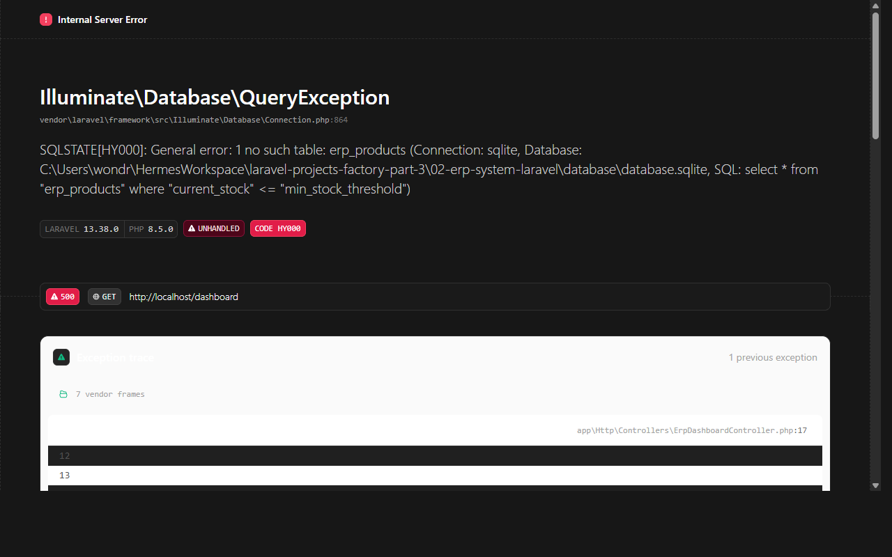

# Real-Time Trading Dashboard (Laravel 12 / Breeze / Tailwind / SQLite)

A modern, high-precision financial trading and portfolio management application built with Laravel, Tailwind CSS, and Blade. Features real-time tickers, order placement console (Market & Limit orders), holdings management, candlestick charts, and atomic ledger accounting in integer minor units.

## Features

- **Integer Monetary Precision**: All balances, order valuations, trade executions, and transaction records are maintained in integer cents (`cash_balance_cents`, `price_cents`, `total_cents`) to eliminate floating-point rounding errors.
- **Interactive Trading Terminal**: Multi-asset trading pair selector (BTC, ETH, SOL, NVDA, AAPL) with 24h highs, lows, volumes, and candlestick price charts.
- **Order Placement Engine**: Instant Market Buy/Sell orders and Open Limit orders with automatic balance checks, holding updates, and transaction logging in `DB::transaction()`.
- **Portfolio & Asset Valuation**: Real-time mark-to-market position calculations, average buy price tracking, and simulated cash deposits.
- **Watchlist & Order Book**: Quick watchlist pinning and execution feed.

## Tech Stack

- **Backend**: Laravel 12.x (PHP 8.3+)
- **Authentication**: Laravel Breeze
- **Database**: SQLite (local & testing), PostgreSQL ready
- **Frontend**: Blade, Tailwind CSS, Vite

## Setup & Testing

```bash
cp .env.example .env
php artisan key:generate
touch database/database.sqlite
php artisan migrate --seed
npm install
npm run build
php artisan test
```


## Screenshots

### Dashboard Overview


### Login Overview


### Orders Overview

